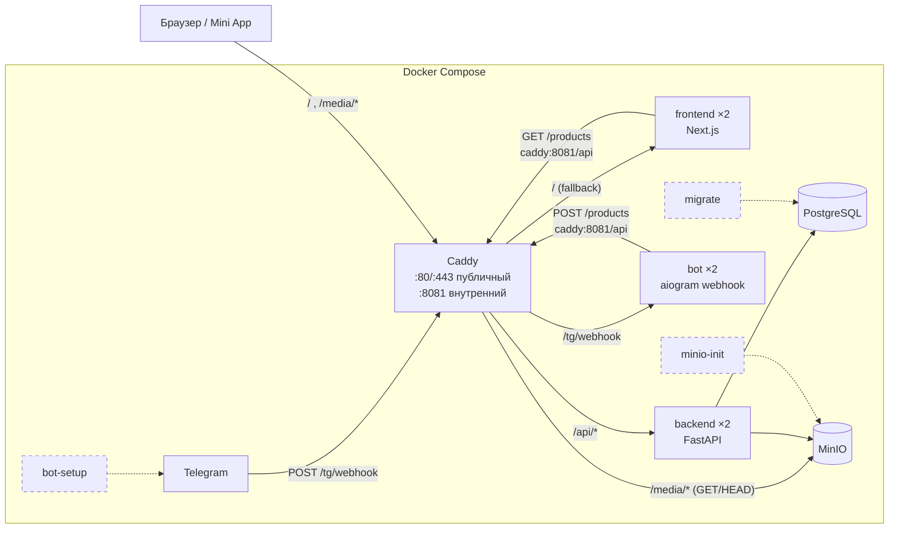

# Test Catalog

Каталог товаров: администратор добавляет товар через Telegram-бота (фото + подпись = название),
пользователи смотрят каталог на веб-странице, которая открывается и в браузере, и как Telegram Mini App.
Все сервисы (backend, bot, frontend) работают в нескольких репликах одновременно и не хранят состояние в процессе.

- **Демо:** https://84-235-235-20.sslip.io (API: https://84-235-235-20.sslip.io/api/products)
- **Бот:** [@invix_test_task_bot](https://t.me/invix_test_task_bot)
- **Репозиторий:** https://github.com/Lucifercute/test-catalog

Содержание: [Архитектура](#архитектура) · [Стек](#стек) · [Быстрый старт](#быстрый-старт-локально) ·
[Бот](#как-пользоваться-ботом) · [**Отказоустойчивость**](#отказоустойчивость) · [Решения](#ключевые-решения-и-почему) ·
[Ограничения](#ограничения-и-что-было-бы-в-продакшене) · [Тесты](#тесты) · [Деплой](#деплой) · [Claude Code](#как-использовался-claude-code)

## Архитектура



Пунктир — one-shot сервисы: отрабатывают и завершаются (`Exited (0)`), app-сервисы ждут их через
`depends_on: condition: service_completed_successfully` / `service_healthy`.

Поток создания товара: админ шлёт фото с подписью → Telegram → Caddy → любая реплика бота → бот скачивает фото
в память → `POST /api/products` через Caddy → любая реплика backend → картинка в MinIO, строка в Postgres
(в БД хранится только ключ объекта `products/{chat_id}/{message_id}.{ext}`).

**Caddy — единственная точка входа**, наружу опубликованы только 80/443 (+443/udp). Маршруты (`infra/Caddyfile`, сниппет `(app)`):

| Путь | Куда | Детали |
|---|---|---|
| `/healthz` | сам Caddy | `200 OK`, для healthcheck контейнера |
| `/api/*` | backend-реплики :8000 | префикс `/api` срезается; `dynamic a backend` — каждая реплика отдельный upstream, `round_robin`, `lb_retries 2`, `fail_duration 10s`, без sticky-сессий |
| `/media/*` | MinIO `/$MINIO_BUCKET/*` | только GET/HEAD (иначе `405`), query string сбрасывается, `/media/` → `404` (листинг bucket скрыт) |
| `/tg/webhook` | bot-реплики :8080 | только POST (иначе `405`), путь сохраняется; секрет `X-Telegram-Bot-Api-Secret-Token` проверяет бот (`401`) |
| всё остальное | frontend-реплики :3000 | та же балансировка, что у `/api` |

Те же маршруты обслуживают два сайта: публичный `{$SITE_ADDRESS}` (локально `:80` → хост-порт 8080; на сервере
домен с автоматическим HTTPS) и внутренний `:8081`, который никогда не публикуется. Бот и frontend ходят в backend
через `http://caddy:8081/api`, поэтому их запросы тоже балансируются между репликами backend.

## Стек

| Слой | Технологии |
|---|---|
| backend | Python 3.12, FastAPI ≥ 0.161, SQLAlchemy 2.0 (async) + asyncpg, Alembic, Pydantic v2 / pydantic-settings, aiobotocore (S3), uvicorn |
| bot | Python 3.12, aiogram ≥ 3.31 (webhook, aiohttp), httpx |
| frontend | Next.js 16.4.3 (App Router, standalone), React 19.3, TypeScript 5.9.3, Node 24.17 |
| данные | PostgreSQL 18.6, MinIO (`pgsty/minio`, `pgsty/mc`) |
| инфраструктура | Caddy 2.11.7, Docker Compose, uv 0.11.25 |
| тесты/линтеры | pytest + pytest-asyncio, testcontainers (Postgres + MinIO), ruff, `tsc --noEmit` |

## Быстрый старт (локально)

**Требования:** Docker с Compose v2 (нужна поддержка тега `!override`). Для работы с ботом — HTTPS-туннель
(например, `cloudflared`). Порты хоста: 8080 (Caddy), 5432 (Postgres), 9000/9001 (MinIO) — только в dev,
их добавляет `compose.override.yaml`.

### 1. `.env`

```bash
cp .env.example .env
```

Обязательные переменные (в `compose.yaml` помечены `:?` — без них Compose не запустится):

| Переменная | Что вписать |
|---|---|
| `POSTGRES_USER`, `POSTGRES_PASSWORD`, `POSTGRES_DB` | любые |
| `MINIO_ROOT_USER`, `MINIO_ROOT_PASSWORD`, `MINIO_BUCKET` | пароль MinIO — минимум 8 символов |
| `MEDIA_BASE_URL` | оставить `/media` |
| `INTERNAL_TOKEN` | общий секрет бот ↔ backend, ≥ 16 символов: `openssl rand -hex 32` |
| `BOT_TOKEN` | у [@BotFather](https://t.me/BotFather) → `/newbot` |
| `WEBHOOK_SECRET` | `openssl rand -hex 32` |
| `PUBLIC_BASE_URL` | HTTPS-адрес туннеля, например `https://xxx.trycloudflare.com` |
| `WEBAPP_URL` | тот же адрес со слешем на конце: `https://xxx.trycloudflare.com/` |
| `ADMIN_IDS` | ваш Telegram user id (узнать у [@userinfobot](https://t.me/userinfobot)); несколько — через запятую |

**Зачем туннель.** Бот работает только через webhook, а Telegram отправляет webhook исключительно на HTTPS и
только на порты 443/80/88/8443. Локальный Caddy слушает plain HTTP на 8080, поэтому нужен туннель:

```bash
cloudflared tunnel --url http://localhost:8080   # напечатает https://<что-то>.trycloudflare.com
```

> ⚠️ **Для локального запуска нужен отдельный бот.** У одного токена может быть только один webhook.
> `bot-setup` вызывает `setWebhook` на ваш `PUBLIC_BASE_URL` — с токеном боевого бота это перехватит
> его у сервера. Создайте dev-бота у @BotFather и используйте его токен.

### 2. Запуск

```bash
docker compose up -d
docker compose ps -a
```

Ожидаемо: `postgres`, `minio`, `caddy`, `backend-1/2`, `bot-1/2`, `frontend-1/2` — `Up (healthy)`;
`migrate`, `minio-init`, `bot-setup` — `Exited (0)`. Без живого туннеля `bot-setup` завершится с `Exited (1)`
(`bad webhook: Failed to resolve host`) — каталог и API при этом работают. Когда туннель поднят и URL вписан в
`.env`, перерегистрировать webhook:

```bash
docker compose run --rm bot-setup
```

> ⚠️ **Не экспортируйте `.env` в шелл** (`set -a; . ./.env`, `export $(cat .env)` и т. п.). Переменные окружения
> шелла имеют приоритет над `.env`, и `docker compose` молча возьмёт старые значения из шелла — например,
> поднимет стек с прежним `BOT_TOKEN`. В командах ниже нужная переменная читается из `.env` точечно через `grep`
> и не экспортируется. Если уже экспортировали — откройте новый терминал или `unset` эти переменные.

### 3. Где что открывается

| Адрес | Что |
|---|---|
| http://localhost:8080/ | каталог (пустой — «Товаров пока нет») |
| http://localhost:8080/api/health | `{"status":"ok"}` (проверяет и БД) |
| http://localhost:8080/api/products | JSON-список товаров (`?limit=1..200&offset=`) |
| http://localhost:8080/media/products/... | картинки товаров |
| http://localhost:9001 | консоль MinIO (только dev), логин — `MINIO_ROOT_USER`/`MINIO_ROOT_PASSWORD` |
| `localhost:5432` | Postgres (только dev) |

Товар можно создать без бота — тем же запросом, что делает бот:

```bash
INTERNAL_TOKEN=$(grep '^INTERNAL_TOKEN=' .env | cut -d= -f2-)
curl -H "X-Internal-Token: $INTERNAL_TOKEN" -F title=Mug -F chat_id=1 -F message_id=1 \
     -F image=@mug.jpg localhost:8080/api/products
```

## Как пользоваться ботом

**Обычный пользователь**
- `/start` или любое сообщение → «У меня есть товар» и кнопка **«Открыть каталог»** (Mini App).
- Кнопка меню **«Каталог»** слева от поля ввода открывает тот же каталог.
- Кнопка «Создать товар» обычному пользователю не показывается; если нажать её из чужого сообщения — «Нет доступа».

**Администратор** (id в `ADMIN_IDS`)
- `/new` (виден только админам) или кнопка **«Создать товар»** → инструкция.
- Отправить **одно сообщение: фото + подпись**. Подпись = название (1–255 символов). FSM нет — диалог не нужен.
- Ответы бота: «Товар «…» добавлен.» / «Товар «…» уже был добавлен.» (повтор того же сообщения) /
  «Товар не добавлен: …» (фото слишком большое, неподдерживаемый формат, плохое название).
- Фото без подписи → просьба добавить подпись. В альбоме товар создаётся из фото с подписью, остальные молча пропускаются.
- Каталог обновляется сразу: страница рендерится на каждый запрос.

## Отказоустойчивость

Жёсткое требование: каждый сервис работает в нескольких репликах одновременно (в `compose.yaml` —
`deploy.replicas: 2` для backend, bot, frontend), любой запрос может попасть на любую реплику, любая реплика
может упасть или перезапуститься.

### Что значит stateless для каждого сервиса

| Сервис | Состояние живёт в… | Как достигнуто |
|---|---|---|
| **backend** | только Postgres и MinIO | Engine/пул соединений и S3-клиент создаются в `lifespan` на процесс (`app.state`), а не как глобальные кэши (`backend/app/main.py`). Никаких локальных файлов: картинка читается в память и сразу уходит в MinIO. В БД — только ключ объекта. Миграции не запускаются на старте — это делает one-shot `migrate`. Создание товара идемпотентно (см. ниже) — повтор на другой реплике безопасен, включая гонку двух реплик. |
| **bot** | у Telegram (очередь апдейтов) | Только webhook, polling нет (`bot/app/main.py`). `Dispatcher(disable_fsm=True)` — нет MemoryStorage: каждый сценарий укладывается в одно сообщение, любой апдейт может обработать любая реплика. Фото скачивается в `BytesIO`, не на диск. httpx-клиент создаётся в `dp.startup` и лежит в `dp["backend"]`, не в глобале. `set_webhook` вызывает только one-shot `bot-setup`, реплики — никогда. |
| **frontend** | нигде (данные берёт у backend) | `dynamic = 'force-dynamic'` + `fetch(..., { cache: 'no-store' })` — нет build-time пререндера и Data Cache, который расходился бы между репликами. `` вместо `next/image` и `images.unoptimized` — оптимизатор кэшировал бы на диск каждой реплики. Обе реплики из одного образа, хэши `/_next/static/*` совпадают — sticky-сессии не нужны. |
| **Caddy** | — | `dynamic a <service>` резолвит A-записи Docker DNS каждые 5 с: каждая реплика — отдельный upstream, новые реплики подхватываются без перезапуска. Пассивные health checks + `lb_retries 2` уводят запросы с упавшей реплики. |

### Сценарии проверки

Все команды запускаются из корня репозитория на поднятом локальном стеке и проверены на нём.
Имена контейнеров — `test-catalog-<service>-<n>` (Compose project `test-catalog`).

**1. Остановка одной реплики backend** — запросы продолжают обслуживаться второй репликой.

```bash
docker stop test-catalog-backend-1
for i in $(seq 1 10); do curl -s -o /dev/null -w '%{http_code} ' localhost:8080/api/health; done; echo
docker start test-catalog-backend-1
```

Ожидаемо: `200 200 200 200 200 200 200 200 200 200` — ни одной ошибки: если Caddy выбрал мёртвую реплику,
`lb_retries` повторяет запрос на живую, а `fail_duration` исключает её на 10 с.

**2. Остановка реплики frontend**

```bash
docker stop test-catalog-frontend-1
for i in $(seq 1 10); do curl -s -o /dev/null -w '%{http_code} ' localhost:8080/; done; echo
docker start test-catalog-frontend-1
```

Ожидаемо: десять `200`.

**3. Остановка реплики bot**

```bash
docker stop test-catalog-bot-1
for i in $(seq 1 10); do curl -s -o /dev/null -w '%{http_code} ' -X POST localhost:8080/tg/webhook; done; echo
docker start test-catalog-bot-1
```

Ожидаемо: десять `401` — запрос без секрета дошёл до живой реплики бота и был отклонён ей самой
(а не `502` от Caddy). Настоящие апдейты Telegram в это время обрабатывает вторая реплика.

**4. Backend недоступен целиком**

```bash
docker compose stop backend
for i in $(seq 1 10); do curl -s -o /dev/null -w '%{http_code} ' localhost:8080/api/health; done; echo
curl -s -o /dev/null -w '%{http_code}\n' localhost:8080/
curl -s localhost:8080/ | grep -o 'Не удалось загрузить каталог'
```

Ожидаемо: API отвечает `502`/`503` (бэкендов нет), а каталог — `200` с текстом «Не удалось загрузить каталог.
Попробуйте обновить страницу позже.»: frontend не падает, у запроса к backend таймаут 5 с.

Telegram в этот момент (нужен туннель и dev-бот): админ отправляет фото с подписью → реплика бота получает
`httpx.TransportError`/`5xx` → `BackendUnavailable` пробрасывается из хэндлера → webhook отвечает `500`
(`handle_in_background=False`) → Telegram повторяет доставку, возможно, на другую реплику. Видно так:

```bash
BOT_TOKEN=$(grep '^BOT_TOKEN=' .env | cut -d= -f2-)
curl -s "https://api.telegram.org/bot$BOT_TOKEN/getWebhookInfo"
# ожидаемо: "pending_update_count" > 0, в "last_error_message" — ответ 500 от webhook
```

Возвращаем backend:

```bash
docker compose start backend
```

Через ~10 с `/api/health` снова `200`; при следующей повторной доставке Telegram товар создаётся, бот отвечает
«Товар «…» добавлен.», `pending_update_count` → 0. Эта часть сверена с кодом (`bot/app/handlers.py`,
`bot/app/backend.py`, `bot/app/main.py`) и тестами `bot/tests/test_webhook.py`, локально без туннеля не прогоняется.

**5. Идемпотентность `POST /products`**

```bash
INTERNAL_TOKEN=$(grep '^INTERNAL_TOKEN=' .env | cut -d= -f2-)
printf '\xff\xd8\xff\xe0\x00\x10JFIF\x00' > /tmp/test.jpg   # заглушка с JPEG magic bytes (или любой .jpg)
for i in 1 2; do
  curl -s -w ' -> %{http_code}\n' -H "X-Internal-Token: $INTERNAL_TOKEN" \
       -F title=Mug -F chat_id=-1 -F message_id=1 -F image=@/tmp/test.jpg localhost:8080/api/products
done
```

Ожидаемо:

```
{"id":7,"title":"Mug","image_url":"/media/products/-1/1.jpg","created_at":"..."} -> 201
{"id":7,"title":"Mug","image_url":"/media/products/-1/1.jpg","created_at":"..."} -> 200
```

Тот же `id`, вторая строка не создана, картинка перезаписана по тому же ключу. Ошибки:

```bash
curl -s -w ' -> %{http_code}\n' -F title=Mug -F chat_id=-1 -F message_id=1 -F image=@/tmp/test.jpg \
     localhost:8080/api/products                                     # {"detail":"invalid token"} -> 401
echo hello > /tmp/test.txt
curl -s -w ' -> %{http_code}\n' -H "X-Internal-Token: $INTERNAL_TOKEN" -F title=Mug -F chat_id=-1 \
     -F message_id=2 -F "image=@/tmp/test.txt;type=image/jpeg" localhost:8080/api/products   # -> 415
```

(`415`: Content-Type заявлен как JPEG, но magic bytes не совпадают.) Убрать тестовый товар:

```bash
docker compose exec postgres sh -c 'psql -U "$POSTGRES_USER" -d "$POSTGRES_DB" -c "DELETE FROM products WHERE chat_id = -1"'
```

**6. Масштабирование `--scale`**

```bash
docker compose up -d --no-deps --scale backend=3 backend
docker compose ps backend                     # три реплики, дождаться (healthy)
sleep 6                                       # Caddy перечитывает DNS каждые 5 с
for i in $(seq 1 30); do curl -s -o /dev/null localhost:8080/api/products; done
docker compose logs --since 15s backend | grep 'GET /products' | cut -d' ' -f1 | sort | uniq -c
docker compose up -d --no-deps --scale backend=2 backend
```

Ожидаемо: `10 backend-1`, `10 backend-2`, `10 backend-3` — Caddy подхватил новую реплику без перезагрузки и
равномерно распределяет запросы (round robin). Так же масштабируются `bot` и `frontend`.
`--no-deps` — чтобы не перезапускать one-shot сервисы.

## Ключевые решения и почему

- **Webhook + `handle_in_background=False`.** Polling с двумя репликами не работает: Telegram
  допускает только один активный `getUpdates` на токен, вторая реплика получает `409 Conflict`.
  Webhook отдаёт каждый апдейт одной реплике. Ответ Telegram отправляется только после завершения хэндлера: временная ошибка (backend лежит, 5xx/429, сеть Telegram) → `500` →
  Telegram передоставит апдейт. С `True` апдейт подтверждался бы сразу и терялся при сбое.
  Постоянные ошибки (413/415/422/401, `TelegramForbiddenError`/`TelegramBadRequest`) сообщаются админу и
  подтверждаются `200`, чтобы Telegram не повторял бесконечно. Общего catch-all обработчика ошибок нет
  намеренно — он убил бы ретраи.
- **Ключ идемпотентности `(chat_id, message_id)`.** Это естественный идентификатор сообщения Telegram,
  одинаковый при каждой повторной доставке. В БД — `UNIQUE (chat_id, message_id)`, вставка через
  `INSERT … ON CONFLICT DO NOTHING RETURNING` (гонка двух реплик → вторая получает `200` с существующим товаром).
  Ключ объекта в MinIO детерминированный (`products/{chat_id}/{message_id}.{ext}`) — повтор перезаписывает
  тот же объект, а не плодит новые.
- **One-shot `migrate`, `minio-init`, `bot-setup`.** Если миграции/создание bucket/`setWebhook` делать на
  старте приложения, N реплик делают это N раз параллельно (гонки миграций, лишние `setWebhook`).
  Отдельные сервисы выполняются один раз, идемпотентны, app-сервисы ждут их успешного завершения.
- **`dynamic a` в Caddy.** Статический `reverse_proxy backend:8000` резолвит имя в один адрес — балансировку
  делал бы Docker DNS, без ретраев. `dynamic a` превращает каждую реплику в отдельный upstream: работают
  `round_robin`, пассивные health checks и `lb_retries`, новые реплики подхватываются через 5 с.
  POST повторяется Caddy только при ошибке соединения — апдейт не обработается дважды из-за ретрая прокси.
- **Относительный `MEDIA_BASE_URL=/media`.** Страница и картинки на одном origin Caddy — одинаково работает
  на localhost, через туннель и на домене, без пересборки и CORS.
- **`` вместо `next/image`.** Оптимизатор Next.js кэширует картинки на диск каждой реплики — это и
  локальное состояние, и двойная работа. Картинки уже отдаёт MinIO через Caddy.
- **Наименьшие привилегии.** `migrate` получает только `POSTGRES_*`; `bot-setup` не получает `INTERNAL_TOKEN`;
  `BACKEND_URL` — серверная переменная, не `NEXT_PUBLIC_*`; контейнеры приложений работают не от root
  (`app`, `node`); Postgres/MinIO/реплики не опубликованы, только Caddy 80/443; `/media` — только чтение,
  без листинга bucket и S3-подресурсов; backend проверяет токен через `secrets.compare_digest`,
  тип картинки — по magic bytes, размер — до чтения целиком.
- **Форк MinIO (`pgsty/minio`, `pgsty/mc`).** Официальные образы `minio/*` больше не публикуются;
  pgsty собирает их из upstream-исходников, версии закреплены.
- **Ресурсы и логи.** У каждого сервиса `memory` limit и ротация логов (10 МБ × 3) — сервер общий.

## Ограничения и что было бы в продакшене

- **Один Caddy** — единственная точка отказа (как и один хост). В проде: несколько экземпляров за внешним
  балансировщиком / keepalived, или managed LB + несколько нод (Swarm/Kubernetes).
- **Один Postgres и один MinIO** без репликации и бэкапов. В проде: managed Postgres / Patroni, MinIO в
  distributed-режиме или S3, регулярные бэкапы.
- **backend ходит в MinIO под root-учёткой.** В проде — отдельный пользователь с policy только на
  `PutObject` в свой bucket.
- **Публичный bucket** (anonymous download; листинг скрыт только на уровне Caddy, а MinIO наружу не опубликован).
  В проде — приватный bucket и presigned URL / CDN.
- **sslip.io** — общий wildcard-домен (rate limits Let's Encrypt делятся с другими). В проде — свой домен.
- Нет rate limiting, метрик и централизованных логов; пагинация каталога есть в API, но не на странице.

## Тесты

```bash
# backend — нужен запущенный Docker (testcontainers поднимает Postgres и MinIO тех же версий, что в compose)
(cd backend && uv sync && uv run pytest && uv run ruff check . && uv run ruff format --check .)

# bot — без Docker: фейковая сессия Bot API + httpx MockTransport
(cd bot && uv sync && uv run pytest && uv run ruff check . && uv run ruff format --check .)

# frontend
(cd frontend && npm ci && npm run typecheck && npm run build)
```

## Деплой

Первичная настройка сервера (Oracle Cloud ARM, firewall, SELinux, серверный `.env`) — [docs/deploy.md](docs/deploy.md).
Каждый следующий деплой — `scripts/deploy.sh` (настройки в gitignored `scripts/deploy.conf`, шаблон
`scripts/deploy.conf.example`): проверяет чистое дерево и ветку `main` → push → на сервере `git pull --ff-only`,
проверка, что опубликованы только 80/443, `docker compose up -d --build` → проверка `https://<домен>/api/health`.

Проверка демо:

```bash
curl https://84-235-235-20.sslip.io/api/health      # {"status":"ok"}
curl https://84-235-235-20.sslip.io/api/products    # JSON-список
```

### Структура репозитория

```
├── compose.yaml              # все сервисы, prod-safe (наружу только Caddy 80/443)
├── compose.override.yaml     # dev-порты (Postgres, MinIO, Caddy 8080), локально подхватывается сам
├── .env.example              # все переменные окружения с комментариями
├── infra/Caddyfile           # маршруты, балансировка
├── backend/                  # FastAPI
│   ├── app/                  # main.py (lifespan), api.py (роуты), models.py, storage.py (S3), config.py
│   ├── alembic/              # миграции (запускает сервис migrate)
│   └── tests/
├── bot/                      # aiogram 3, webhook
│   ├── app/                  # main.py (aiohttp + webhook), handlers.py, backend.py (клиент API), setup.py (bot-setup)
│   └── tests/
├── frontend/                 # Next.js App Router
│   ├── app/                  # page.tsx (каталог), layout.tsx, telegram-ready.tsx, health/route.ts
│   └── lib/backend.ts        # server-only запрос к backend
├── scripts/deploy.sh         # деплой на сервер
├── docs/deploy.md            # первичная настройка сервера
├── CLAUDE.md                 # контекст проекта для Claude Code
└── .claude/skills/stateless-review/   # skill проверки на stateless
```

## Как использовался Claude Code

- **`CLAUDE.md`** — «контракт» проекта: архитектура, жёсткие правила (реплики, webhook, идемпотентность,
  one-shot migrate), конвенции стека, команды и workflow (план перед изменениями в нескольких сервисах,
  тесты и линтеры перед «готово», без коммитов без спроса). Обновлялся вместе с кодом.
- **Skill `stateless-review`** (`.claude/skills/stateless-review/`) — проверка любого сервиса на совместимость
  с несколькими репликами: `scripts/scan.py` даёт кандидатов (глобальные кэши, запись файлов, polling, FSM,
  миграции на старте, кэши Next.js…), `references/checklist.md` — чек-лист, в том числе на то, чего *нет*
  (unique-ключа, `migrate`, `secret_token`). Запускался после каждого сервиса.
- **context7 MCP** (`.mcp.json`) — актуальная документация aiogram 3 и Next.js 16 вместо памяти модели:
  API этих библиотек часто меняются.
